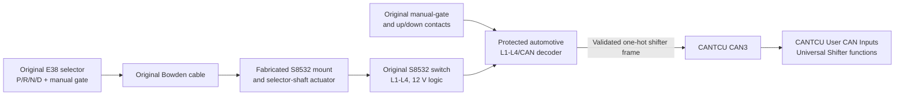
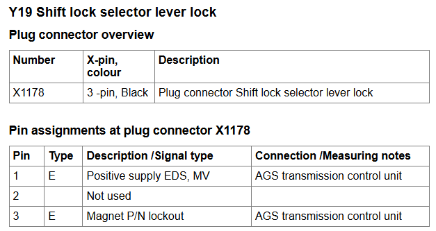
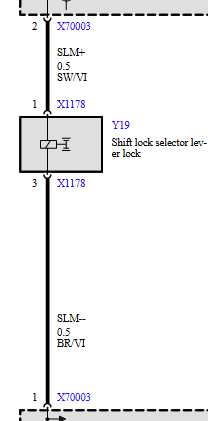
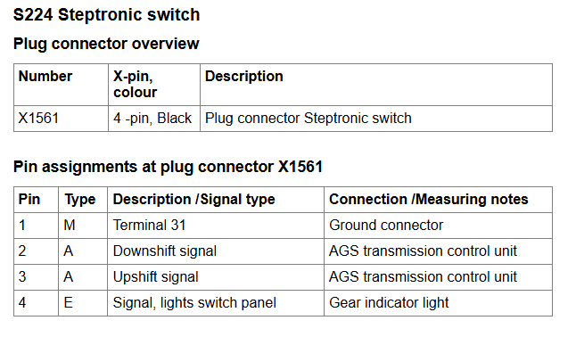
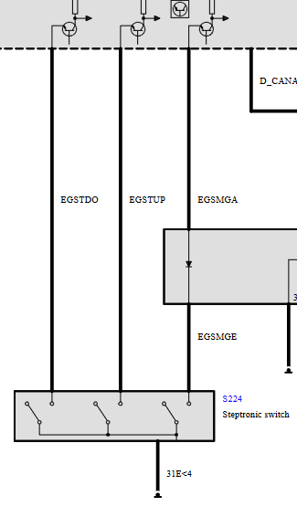
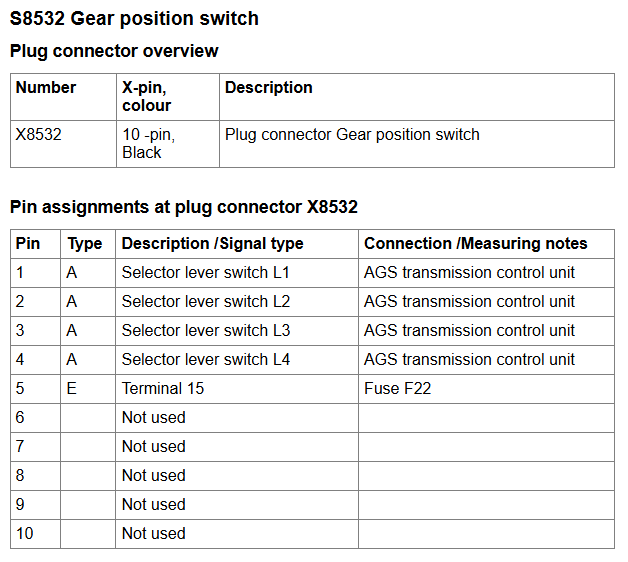
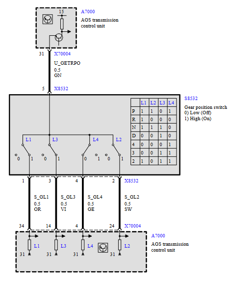
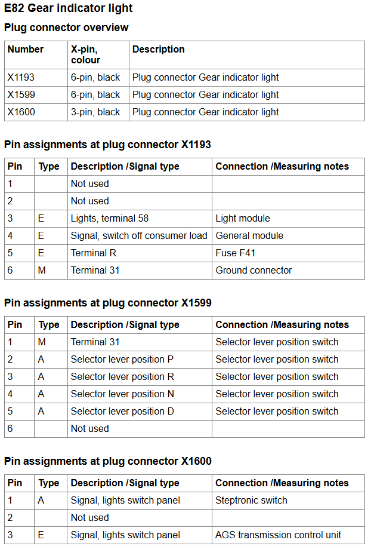
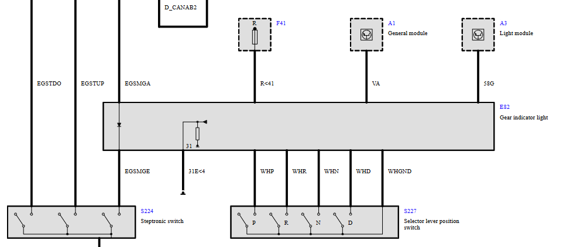

# E38 Selector Integration

This document records the original E38 Steptronic selector wiring and the proposed integration with CANTCU Race+. The original wiring information is extracted from NewTIS.

## Approach A: Direct 0-5 V position encoder

Retain the E38 selector assembly and use the CANformance [Universal DIN/CAN Shifter](https://wiki.canformance.net/CANTCU/integrations/supportedshifters/universalshifter) profile with a modified position-sensing arrangement. CANformance requires `Shifter R`, `Shifter N`, `Shifter D`, `Shifter Mode`, and optionally `Shifter P`. CANTCU supports four analog inputs, four ground-triggered digital inputs, and an analog-input `Rotary Switch` mode that can map up to five voltage positions.

The E38 lever does not itself generate the four-line L1-L4 PRND code described below. That code comes from the selector-position switch on the original 5HP30 transmission, which is removed during the conversion. Do not connect the old L1-L4 circuits or any 12 V selector signal to a CANTCU analog or digital input.

Install an automotive-grade, mechanically keyed position encoder on the E38 selector mechanism. A non-contact 0-5 V rotary or linear sensor is preferred; a sealed resistor ladder may be used only if its wiper remains positively linked to the lever. The encoder must provide four distinct, stable voltages for P, R, N, and D. The manual gate remains at the D longitudinal position and is identified separately by the existing manual-gate switch.

### Proposed input allocation

| E38 function | CANTCU pin | CANTCU configuration | Electrical behavior |
| --- | --- | --- | --- |
| P/R/N/D position encoder | B2 (AIN1) | `Rotary Switch`, positions mapped to `Shifter P/R/N/D` | 0-5 V from the new lever-linked encoder |
| Manual-gate switch | B6 (DIN1) | `Shifter Mode Switch` | Maintained contact to sensor ground in the manual gate |
| Existing shift contact 1 | B7 (DIN2) | `Shifter Gear Up` or `Shifter Gear Down` after direction test | Momentary contact to sensor ground |
| Existing shift contact 2 | C5 (DIN3) | Opposite gear direction after direction test | Momentary contact to sensor ground |
| Brake switch | C6 (DIN4) | `Brake Switch` with verified polarity | Ground-triggered interface; do not connect the E38 12 V brake circuit directly |
| Encoder supply | C2 | +5 V sensor supply | Sensor supply only |
| Encoder/switch return | C7 | Sensor ground | Do not use a power ground as the signal return |

Pins B6, B7, C5, and C6 must only be switched to ground. If the retained E38 switch common is not isolated from vehicle ground or another circuit, rewire it as a dedicated C7 sensor-ground return or use a suitable protected interface. Determine the two momentary contacts by continuity testing and confirm the required up/down direction in CANTCU live data before enabling drive.

### Position-encoder requirements

1. Preserve positive and repeatable mechanical detents for P, R, N, and D; do not rely on sensor friction to hold the lever.
2. Key the sensor coupling so it cannot slip independently of the lever.
3. Measure and record the voltage at every detent with minimum and maximum supply voltage, temperature variation, harness movement, and repeated lever operation.
4. Configure non-overlapping voltage windows with adequate tolerance around each measured value.
5. Bench-test open-circuit, short-to-ground, short-to-5 V, between-detent, and implausible-transition behavior. No electrical fault may create an unintended R or D request.
6. Confirm that the displayed/requested selector state changes once per detent and agrees with the actual transmission state.
7. Use confirmed transmission state, not the lever sensor alone, for reverse lamps and Park/Neutral start authorization.

> [!WARNING]
> This approach is feasible only after CANTCU Race+ is confirmed to support `Rotary Switch` PRND mapping on hardware revision 1.9 and the selected firmware. Do not commission the vehicle if an invalid or transitional encoder voltage can be interpreted as a valid drive range.

## Approach B: Original S8532 switch with CAN decoder

The original E38 gear-position switch S8532 can be retained as an alternative to installing a new position encoder. S8532 is a passive transmission-mounted switch supplied from terminal 15 at X8532 pin 5. It outputs the coded L1-L4 pattern on pins 1-4. Because CANTCU Universal Shifter expects individual P/R/N/D functions rather than the BMW L1-L4 code, connect S8532 to a purpose-built automotive decoder that validates the code and transmits separate shifter functions over CAN3.

This is a modified implementation of CANformance's Universal DIN/CAN Shifter approach:

The Bowden cable drives only the separately mounted S8532 actuator; it must not be connected to or force the 8HP selector mechanism. Fabricate a rigid, guarded mount and shaft/lever that reproduce the original 5HP30 switch travel, angular positions, end stops, and cable geometry. The coupling must be keyed and must not slip. Confirm each code at every selector detent before connecting the decoder to CAN.

### Decoder inputs

| Signal | Source | Decoder requirement |
| --- | --- | --- |
| L1 | S8532 X8532 pin 1 | Protected automotive 12 V digital input |
| L2 | S8532 X8532 pin 2 | Protected automotive 12 V digital input |
| L3 | S8532 X8532 pin 3 | Protected automotive 12 V digital input |
| L4 | S8532 X8532 pin 4 | Protected automotive 12 V digital input |
| Switch supply | S8532 X8532 pin 5 | Fused ignition-switched terminal 15 supply |
| Manual gate | Original Steptronic switch | Protected ground-switching input |
| Shift contact 1 | Original Steptronic switch | Protected ground-switching input |
| Shift contact 2 | Original Steptronic switch | Protected ground-switching input |

The decoder inputs must tolerate vehicle supply variation, reverse battery, load-dump and inductive transients, and open or shorted wiring. Use an automotive-rated power supply, watchdog, CAN transceiver, enclosure, connector, and input protection. Do not connect the 12 V L1-L4 lines directly to CANTCU.

### L1-L4 decoding

Accept only the exact documented patterns:

| Requested range | L1 | L2 | L3 | L4 |
| --- | ---: | ---: | ---: | ---: |
| P | 1 | 1 | 0 | 1 |
| R | 1 | 0 | 0 | 0 |
| N | 1 | 1 | 1 | 0 |
| D | 0 | 0 | 1 | 0 |

Treat every other pattern, including the legacy `4`, `3`, and `2` codes, as invalid for this Steptronic conversion. During a lever transition, clear all P/R/N/D requests until one valid code has remained stable for the validated debounce period. Output must always be one-hot: never assert more than one range request.

Read the manual-gate switch as a maintained `Shifter Mode Switch`. Debounce the two momentary contacts and assign `Shifter Gear Up` and `Shifter Gear Down` only after direction testing.

### Proposed CAN3 interface

Use one collision-free CAN identifier and bitrate agreed with CANformance after capturing the existing DDE/CAN3 traffic. The example payload below defines the required information but does not assign an identifier:

| Byte/bit | Signal | Behavior |
| --- | --- | --- |
| Byte 0 bit 0 | Shifter P | One-hot, valid stable P code only |
| Byte 0 bit 1 | Shifter R | One-hot, valid stable R code only |
| Byte 0 bit 2 | Shifter N | One-hot, valid stable N code only |
| Byte 0 bit 3 | Shifter D | One-hot, valid stable D code only |
| Byte 0 bit 4 | Shifter Mode | Maintained manual-gate state |
| Byte 0 bit 5 | Shifter Gear Up | Debounced momentary request |
| Byte 0 bit 6 | Shifter Gear Down | Debounced momentary request |
| Byte 0 bit 7 | Selector valid | Valid stable L1-L4 code and healthy decoder |
| Byte 1 low nibble | Rolling counter | Increments with each transmitted frame |
| Byte 1 high nibble | Fault status | Nonzero for supply, input, code, watchdog, or CAN fault |

Map the seven shifter bits to the corresponding CANTCU User CAN Inputs. The decoder must transmit all range requests as zero when the L1-L4 code is invalid, during transition, or when an internal fault is detected.

Before selecting this design, obtain written CANformance confirmation of:

1. The exact Universal Shifter CAN-input variables and whether P should be transmitted.
2. CAN3 bitrate and a message identifier that cannot conflict with the M67 master DDE integration.
3. CAN-input timeout behavior. Loss of decoder frames must clear every range and shift request rather than retain the last value.
4. Whether CANTCU can use the valid, counter, and fault signals for plausibility monitoring.
5. Safe behavior if CAN3 is bus-off, shorted, overloaded, or disconnected while a drive range is active.

If CANTCU cannot guarantee stale-message timeout and invalid-state handling, do not use this CAN decoder as the sole selector input. Add a CANformance-approved hardwired validity/interlock path or use a supported selector interface with defined fail-safe behavior.

### Acceptance tests

1. Verify all four L1-L4 voltages and decoded states at P, R, N, and D.
2. Sweep slowly and rapidly between every adjacent position; no intermediate code may request a range.
3. Open and short each L1-L4 wire individually to ground and battery voltage.
4. Disconnect S8532 supply, decoder supply, decoder ground, and CAN3 individually.
5. Hold or corrupt the CAN frame, stop transmission, corrupt the rolling counter, and force decoder watchdog reset.
6. Confirm no single tested fault requests R or D, permits starting outside confirmed P/N, or defeats the shift lock.
7. Verify manual-mode entry and both shift directions without unintended repeated requests.
8. Repeat at minimum and maximum operating voltage and across the expected temperature range.

## Shiftlock

It is only possible to shift out of the positions "P" or "N" after evaluation of the signals:

- Brake (brake light switch or brake light test switch)
- Road speed
- Engine speed
- Time
The selector lever is locked when no brake signal is detected with the engine running and the vehicle stationary. A time delay function of approx. 0.5 s is used for operation under winter conditions. The brake light switch is designed as a normally-opened contact referred to 12 V and the brake light test switch as a normally-open contact referred to ground. The shift lever is locked by way of a solenoid on the selector lever switch.

Retain the E38 shift-lock solenoid, but do not connect it directly to a CANTCU input or assume that a CANTCU output can drive it. Measure its steady-state and inrush current. Use a fused automotive relay or protected driver if the selected CANTCU output is rated for the load; CANTCU digital outputs are ground-switching and limited to `0.5 A`.

The replacement shift-lock control must use verified brake state, vehicle speed, ignition/engine state, and selector/transmission state as required to reproduce safe operation. It must fail locked on loss of power, signal, or controller communication and provide a documented mechanical emergency-release procedure. A brake-only relay is not an acceptable replacement for the original logic.

ShiftSelectorLock-Pinout

ShiftSelectorLock-Wiring

## Steptronic

The Steptronic function makes it possible to shift all gears of the automatic transmission manually. The gear required by the driver is transmitted via three switches (to ground) in the manual gate to the EGS control unit: The "manual gate" switch is closed if the selector lever is moved out of the automatic gate into the manual gate. By pressing the selector lever forward or back, the "strike-up" or "strike-down" contact is additionally closed.

SteptronicSwitch-Pinout

SteptronicSwitch-Wiring

## Selector lever switch

The EGS control unit detects the selector lever position by way of a switch on the transmission. This switch converts the current selector lever position into a code. This selector lever code is transferred via four lines (L1-L4) to the EGS control unit.
| Selector lever position | L1 to L4 (0 = open, 1= U-batt) |
| :---------------------- | :----------------------------- |
| P                       | L1 =1, L2 = 1, L3 = 0, L4 =1   |
| R                       | L1 =1, L2 = 0, L3 = 0, L4 =0   |
| N                       | L1 =1, L2 = 1, L3 = 1, L4 =0   |
| D                       | L1 =0, L2 = 0, L3 = 1, L4 =0   |
| 4 (3)                   | L1 =0, L2 = 0, L3 = 0, L4 =1   |
| 3 (2)                   | L1 =0, L2 = 0, L3 = 1, L4 =1   |
| 2 (1)                   | L1 =1, L2 = 0, L3 = 1, L4 =1   |

Approach A replaces this switch with a lever-mounted 0-5 V encoder. Approach B retains S8532 and decodes this truth table in a protected CAN interface. In neither approach may the 12 V L1-L4 lines connect directly to CANTCU inputs.

GearSelector-Pinout

GearSelector-Wiring

GearIndicatorLight-Pinout

GearIndicatorLight-Wiring

